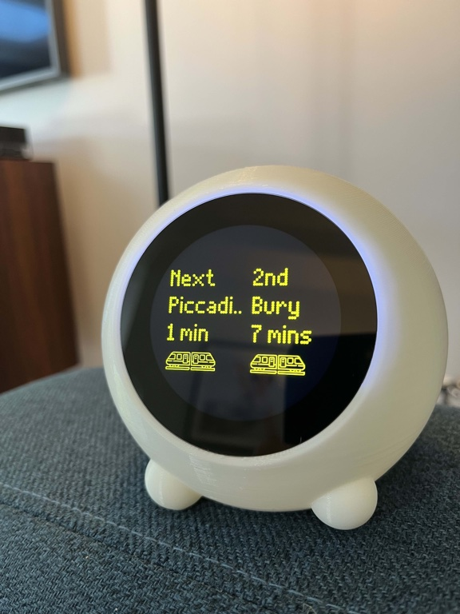
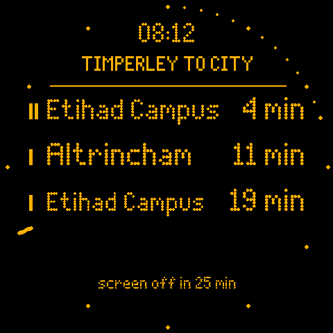
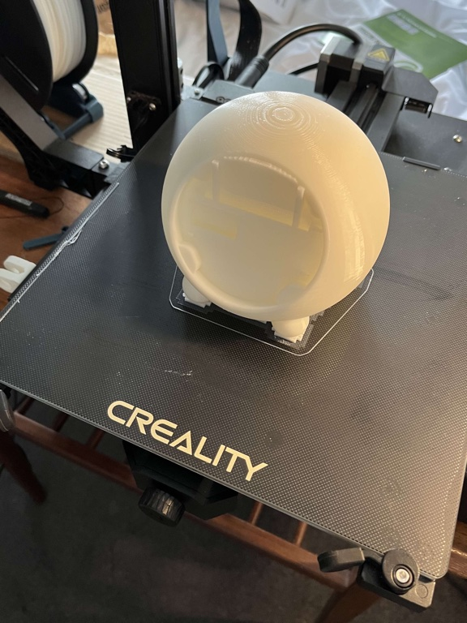
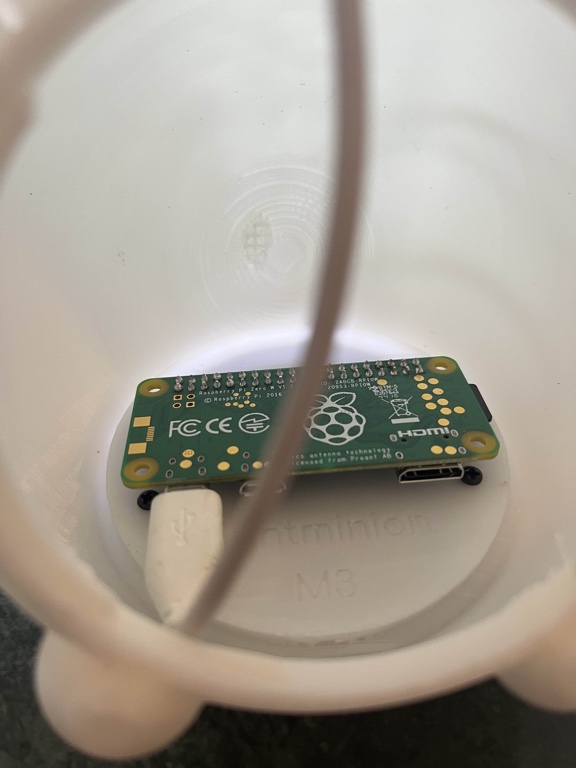

# TFGM Metrolink Clock ⏱🚃 

This repository contains sample code and a build guide for creating your own Metrolink tram time clock. 





**What it does**

* Shows the next three trams for your stop, with **I** / **II** for single or double trams.
* **Off until you tap it**, then on for 30 minutes (configurable). The backlight really switches off, so the screen doesn't ghost or burn in.
* **Tap again** to cycle between stops (e.g. inbound / outbound). **Hold** for 1.5 s to switch off.
* The outer ring is an **analogue clock**, or optionally a countdown of dots to the next tram.
* Service messages (engineering works etc.) scroll along the bottom.
* A **web UI** on your phone to turn it on/off, pick stops by name, set an auto-on schedule (e.g. weekdays 07:30–08:30), and change colour and timings.
* Runs as a systemd service, so it starts on boot and restarts itself if anything goes wrong.

<br clear="right">

You're likely here because you stumbled across [this on Twitter](https://twitter.com/eddible/status/1564917603180617731?s=20&t=dcHyyQINVi-xO-h7mmJiKw). If so, hi! 👋🏻

> As a disclaimer, all the information here is purely offered as guidance and I can't take any responsibility for any damage or problems. That said, feel free to raise an Issue here on GitHub if you have a problem, I'd be more than happy to take a look. Similarly, I'm more than happy to receive pull requests!  
> 
> This is all provided free of charge, but if you find it useful and want to show your appreciation, you can buy me a coffee at the link below - thanks!
> 
> [](https://www.buymeacoffee.com/eddabrahamsen)


## Required hardware
> ⚠️ At the time of writing the screen and Pi are both out of stock. I suspect the screen will be back soon, but the Raspberry Pi remains difficult to buy due to the ongoing chip shortages. [Pi Locator](https://rpilocator.com/) is a great resource for tracking down stock. 
* [Hyperpixel 2.1 Round](https://shop.pimoroni.com/products/hyperpixel-round?variant=39381081882707)
* [Mounting Screws](https://shop.pimoroni.com/products/short-pi-standoffs-for-hyperpixel-round?variant=39384564236371) - You actually only need 4x M2.5 5mm screws but this was just convenient at the time. 
* [Raspberry Pi Zero 2 WH](https://shop.pimoroni.com/products/raspberry-pi-zero-w?variant=39458414297171)  
> ⚠️ You'll need headers on your Pi, the one linked above comes pre-soldered. If you have or buy a Pi without headers, you'll need to solder them on yourself.
* [Micro SD Card for the Pi Zero](https://www.amazon.co.uk/dp/B08GY9NYRM/ref=twister_B0925JD7Z4?_encoding=UTF8&th=1) - Don't use an unbranded/cheap SD Card - stick to decent brands like Samsung to save yourself dealing with random errors.
* [3D Printed Case](https://cults3d.com/en/3d-model/gadget/sphere-enclosure-w-bump-legs-m3o101-for-pimoroni-hyperpixel-2-1-round-touch-and-raspberry-pi) - Massive credit to printminion for the excellent design! The link is to the exact one I printed, but there are variations available.  
* Micro USB cable
* Optional USB plug like a phone charger, but it should power fine from a standard USB port or battery. 

## Build Guide

### Print the case

* 

Printminion provides guidance on the [Cults3D page](https://cults3d.com/en/3d-model/gadget/sphere-enclosure-w-bump-legs-m3o101-for-pimoroni-hyperpixel-2-1-round-touch-and-raspberry-pi) which I followed. I'm using a Creality CR-6 SE and I used eSuns excellent PLA+ which is [readily available on Amazon here in the UK.](https://www.amazon.co.uk/eSUN-Filament-Dimensional-Accuracy-Printing/dp/B081Q7VJGT)

I use Prusa Slicer for my printer, which has a built-in profile for the CR-6 and the eSun PLA (it's down as PLA+ which means it doesn't show up for the CR-6 - just duplicate it and change the material type to PLA and it works just fine). From there I think all I changed was the layer height to 0.3.  

Of course the above is only really relevant to the CR-6 so use your own judgement for your printer. 

It took about 18 hours, and unfortunately you will need support material. Handily it all sits inside so although it's very awkward to remove it (I basically ended up ripping it out using a screwdriver), none of the surfaces the support touches are visible. It's also a good idea to keep the print on the slower side (I stuck with 50mm/s) to ensure you get good adhesion - you don't want it coming apart when removing the supports. I know that Cura offers a 'tree' type support which may well work well for this, let me know if you have any tips from your own prints!

### Flash your Micro SD Card 
> ⚠️ The software for the screen is currently incompatible with the latest versions of Raspbian. As such, you'll want to flash your SD card with the "legacy" version. 
* Download the [Raspberry Pi Imager](https://www.raspberrypi.com/software/) and install it on your computer 
* Launch it with your Micro SD Card plugged into your computer.
* Click `Choose OS` → `Raspberry Pi OS (Other)` → `Raspberry Pi OS Lite (Legacy)`
* Click `Choose Storage` and select your Micro SD card - make sure you're definitely selecting your card! If you're unsure, unplug the card and see what disappears. 
* Click the cog icon down the bottom right
    * Tick on `Enable SSH` → `Use password authentication`
    * Tick on `set username and password` → Leave the username as `pi` and set a password. You'll be typing it in a few times so make it secure but memorable. 
    * Tick on `Configure wifi` → Enter your Wi-Fi details as instructed 
    * Click `Save` when you're done
    
* Click `Write` and wait for the OS to be written to your SD Card
* Insert it into your Pi Zero, connect it to power and give it a few minutes to complete the first boot.  

### Get a TFGM API key
* Go [here](https://developer.tfgm.com/) and register for an account with TFGM
* Once registered and logged in, go [here](https://developer.tfgm.com/developer) and click `Show` next to `Primary Key` - make a note of this key, you'll need it shortly.
* You no longer need to look up your stop's ID - you can search for your station by name in the web UI.

### Installing the software
> The easiest way to manage a device like this is over SSH. If you're struggling with SSH, you should be able to follow along by connecting your Pi to a screen and plugging in a keyboard. The Pi Zero uses mini ports so you'll need some adaptors.

* Open your Terminal (On Windows, you should be able to use Powershell without issue, on macOS you can use Terminal)
* Depending on your network, you should be able to connect to your Pi using this command: `ssh pi@raspberrypi.local`
    * If the above does not work, you'll need to log into your router and find out the IP address the router has assigned to it. From there, you can access it using something like `ssh pi@192.168.1.77`, replacing the IP address for the one on your network.
* Install the screen driver from Pimoroni (skip this if your screen already works):
    * `git clone https://github.com/pimoroni/hyperpixel2r`
    * `cd hyperpixel2r && sudo ./install.sh && cd ..`
* Download the clock and install it:
    * `git clone https://github.com/eddible/tfgm-tram-clock`
    * `cd tfgm-tram-clock`
    * `./install.sh`

  This installs the Python libraries it needs, sets the clock up as a service that starts on boot, and turns off the text login prompt on the screen (it would otherwise draw over the clock - SSH still works).
* At the end it prints the address of the web UI, e.g. `http://192.168.1.77/`. Open that on your phone or computer and:
    * paste your TFGM key under **TfGM API**
    * under **Stops**, tap **Add a stop**, search for your station and add the direction you want. Add a second one (e.g. the other direction) if you like - tapping the clock switches between them.
    * tap **Save changes**
* That's it for the software, let's shutdown the Pi and plug everything in: `sudo shutdown now`

> **Upgrading from the original version?** Run `git pull` then `./install.sh` in your `tfgm-tram-clock` folder. Your API key and stop are carried over from `config.ini`, and the old `tram.sh` line in `/etc/rc.local` is commented out for you.

### Connect the LCD to the Pi

> ⚠️ The screen is very fragile, so I don't want to take mine apart to demonstrate - hopefully this makes sense in text. 
  
* You want to place the screen on the outside, lining it up with the slot on the case, then carefully screw in the 4 screws provided in the stand-off kit. The angle here is really awful so just take your time. I found it worked best with a very thin screwdriver. 
* 
* Plug your Pi's USB cable into it's Power port (it's the outermost port - if you don't plug it in now, it's very awkward to do later)
* You'll now want to line up the headers of your Pi with the socket on the screen and very carefully push them together. Before you do it, read Pimoroni's guidance on connecting the screen: 

> When installing HyperPixel 2.1 Round onto your Pi make sure not to press down on the screen surface. We recommend putting the screen face down on a soft surface and gently wiggling the Pi to mate with the extended header (or GPIO header). If you need to remove your Hyperpixel, take care not to pull on the edges of the glass display - it's best to hold on to the rectangular PCB. As the glass edges of this display overhang the PCB they're quite exposed, so it's worth being extra careful with them.

* Use your fingers to feel around the join of the header and the screen and ensure it's fully seated. On my first attempt I realised I'd only pushed it in about half way. Take it slowly, keep the Pi as level as you can and if you feel a lot of resistance, stop and check. 

### Power it on
* That's it! Plug the clock back into power. After about 20 seconds the times will flash up for a minute so you know it's working, then the screen goes off. Tap it whenever you want to see the trams.

## Using it

| On the screen   | Does                                               |
|-----------------|----------------------------------------------------|
| Tap while off   | Turn on for 30 minutes (change this in the web UI) |
| Tap while on    | Next stop, and restart the timer                   |
| Hold 1.5 s      | Turn off now                                       |

The web UI is at `http://<your pi's address>/`. All settings live in `config.json` in the `tfgm-tram-clock` folder (it holds your API key, so it isn't committed to git).

## Troubleshooting
* **Logs:** `sudo journalctl -u tramclock -f`, or open **Recent log** at the bottom of the web UI.
* **Restart it:** `sudo systemctl restart tramclock`
* **"API key rejected"** on the screen: check the key in the web UI matches your Primary Key on the TFGM developer portal.
* **Run it by hand** without touching the screen (handy for development): `python3 -m tramclock --no-panel --port 8080 --config config.json`

## How the code is laid out

```
tramclock/
  __main__.py    entry point, display loop
  controller.py  wake/sleep state, schedule, touch gestures, fetcher thread
  screen.py      backlight, framebuffer, drawing
  tfgm.py        TfGM API client
  web.py         web UI + JSON API
  config.py      config.json load/validate/save
  static/        web UI page
  assets/        font
```

The display is drawn with pygame straight into the framebuffer. Everything is drawn in one fully-lit colour with no anti-aliasing, because the HyperPixel shows banding on part-lit pixels.
